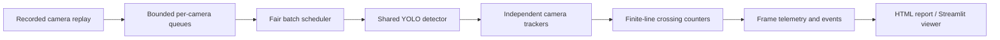

# Traffic Inference Lab

**How many cameras can one machine serve while keeping results fresh and preserving accuracy?**

A computer vision deployment project built around that question: reproducible YOLO runtime comparisons,
export parity gates, independent vehicle tracking and counting, bounded multi-camera scheduling, and a local results dashboard.



## Run locally

Python 3.11–3.13; Python 3.12 recommended. Start in this repository.

```powershell
py -3.12 -m venv .venv
.\.venv\Scripts\Activate.ps1
python -m pip install torch torchvision --index-url https://download.pytorch.org/whl/cpu
python -m pip install -e ".[cpu,dashboard,dev]"
traffic-lab doctor
traffic-lab fetch
```

On Linux/macOS use `python3.12 -m venv .venv` and `source .venv/bin/activate`.
The CPU wheels are intentional for the CPU comparison. Use a separate environment with a compatible CUDA-enabled
PyTorch build for GPU experiments. Do not assume that an installed NVIDIA driver makes CPU-only PyTorch use CUDA.

Run the measured CPU suite (exports, six benchmarks, parity, and multi-camera experiments):

```powershell
python scripts/run_experiments.py --evaluate
python -m streamlit run dashboard.py
```

Open [the checked-in HTML report](results/report.html) by downloading/opening it locally, or launch the dashboard.
The HTML report is standalone; GitHub's file preview does not execute it. See [the measured findings](docs/RESULTS.md)
and [methodology](docs/METHODOLOGY.md) before quoting a result.

## Individual experiments

```powershell
traffic-lab export --format onnx --dynamic --batch 4 --output-dir models/onnx
traffic-lab benchmark --model models/onnx/yolo11n.onnx --source data/traffic.mp4 --imgsz 320 --output results/onnx-320.json
traffic-lab parity --candidate models/onnx/yolo11n.onnx --source data/traffic.mp4 --output results/parity-onnx-320.json
traffic-lab evaluate --model models/onnx/yolo11n.onnx --data coco128.yaml --output results/eval-onnx-320.json
traffic-lab run --sources data/traffic.mp4 data/traffic.mp4 --duration 5 --output results/two-cameras --render
traffic-lab report --input results --output results/report.html
traffic-lab gate --benchmark results/onnx-320.json --evaluation results/eval-onnx-320.json --baseline-evaluation results/eval-pytorch-320.json --output results/gate-onnx.json
```

For `run`, change `--tracker botsort`, `--stride 2`, `--queue-size 1`, `--batch 2`, and
`--line 0.1 0.55 0.9 0.55` independently to study their effects. Batches are opportunistic maxima;
the scheduler does not wait to fill them. Use dynamic exports when shapes/batch sizes vary.
`--zone x1 y1 x2 y2` controls the normalized occupancy rectangle. If FFmpeg is installed,
rendered videos also receive an H.264 browser copy after the timed run; otherwise use a local video player.

Optional hardware-dependent paths (provided, not assumed benchmarked):

```powershell
# Build on the NVIDIA deployment machine with compatible CUDA/TensorRT installed.
traffic-lab export --format engine --device 0 --half --dynamic --batch 4 --output-dir models/trt-fp16
# Calibrate only on an independent, representative dataset; install .[int8] first.
traffic-lab export --format openvino --int8 --data path/to/calibration.yaml --output-dir models/ov-int8
# Score human-annotated line-crossing events, not model-generated labels.
traffic-lab count-score --predictions results/two-cameras/events.json --labels path/to/labels.json --output results/count-quality.json
# Each drift input must contain one camera.
traffic-lab drift --reference path/to/reference/frames.jsonl --current path/to/current/frames.jsonl --output results/drift.json
```

## What this demonstrates

- **Profiling:** isolate decode/queue/model/tracker/render time and tail latency.
- **Runtime engineering:** consistent preprocessing, explicit export settings, and detection parity checks.
- **Load handling:** bounded latest-frame queues, drop accounting, fair scheduling, per-camera tracker isolation.
- **Optimization judgment:** compare runtime/input-size/batching/stride tradeoffs instead of assuming faster is better.
- **Evidence:** raw measurements, hashes, environment records, repeatable commands, and explicit failure logs.
- **Quality discipline:** labeled mAP evaluation and independent event scoring; unknown quality remains unknown.

The initial evaluation uses COCO128 as a **smoke set**. It is not an independent traffic benchmark. The short road clip
tests the implementation and runtime behavior; repeat it on long, diverse clips for stable tail/capacity claims.
Counts in demos are unvalidated. No training, calibrated speed, production SLA, cloud savings, or energy efficiency is claimed.

## Repository map

| Path | Purpose |
|---|---|
| `src/traffic_lab/runtime.py` | Model adapter, hardware metadata, artifact hashes |
| `benchmark.py` | Repeated timing, export parity, labeled evaluation |
| `pipeline.py` | Paced replay, bounded queues, per-camera tracking |
| `metrics.py`, `scoring.py` | Counting, drift diagnostics, Pareto selection, event scoring |
| `report.py`, `dashboard.py` | Portable report and local results viewer |
| `scripts/run_experiments.py` | Sequential isolated benchmark processes |
| `results/` | Actual measurements and experiment logs |
| `tests/` | Queue/crossing/matching/drift/report regression tests |

```powershell
python -m pytest -q
python -m ruff check .
```

Read [data provenance](docs/DATA.md), [benchmark protocol](docs/METHODOLOGY.md), and
[deployment decisions](docs/DECISIONS.md). Weights, videos, calibration images, and secrets are excluded from Git.

## Learning references

Based on the questions covered by [Ultralytics YOLO in Production](https://academy.ultralytics.com/courses/yolo-in-production):
[deployment target](https://academy.ultralytics.com/courses/yolo-in-production/choose-a-deployment-target),
[ONNX parity](https://academy.ultralytics.com/courses/yolo-in-production/export-to-onnx),
[TensorRT](https://academy.ultralytics.com/courses/yolo-in-production/optimize-with-tensorrt),
[OpenVINO](https://academy.ultralytics.com/courses/yolo-in-production/openvino-on-cpu),
[tracking](https://academy.ultralytics.com/courses/yolo-in-production/tracking-with-bytetrack-and-botsort),
[counting](https://academy.ultralytics.com/courses/yolo-in-production/counting-heatmaps-and-speed),
[multi-stream inference](https://academy.ultralytics.com/courses/yolo-in-production/multi-stream-inference),
[observability](https://academy.ultralytics.com/courses/yolo-in-production/observability-and-drift), and
[cost/latency tuning](https://academy.ultralytics.com/courses/yolo-in-production/cost-and-latency-tuning).
Implementation uses the [export](https://docs.ultralytics.com/modes/export/),
[tracking](https://docs.ultralytics.com/modes/track/), and
[OpenVINO](https://docs.ultralytics.com/integrations/openvino/) APIs.
