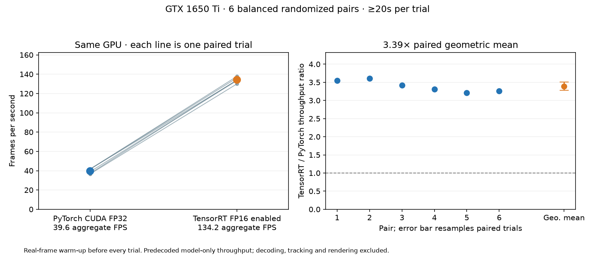

# Same-GPU confirmation study

TensorRT FP16 enabled versus PyTorch CUDA FP32, YOLO11n at 320px: **3.39×** paired geometric-mean
throughput ratio; exploratory 95% paired-trial bootstrap interval **3.28–3.50×**.

Aggregate throughput: **39.58 FPS → 134.17 FPS**. Each backend ran 6 trials
of at least 20 seconds, with three PyTorch-first and three TensorRT-first pairs randomized by seed.



## Protocol and quality

- Both models resident on the same GTX 1650 Ti, executed sequentially with the same CPU thread setting and batch one.
- A 60-frame every-other-frame pool spans the first 120 source frames. Each trial processes complete cycles only,
  so the frame mixture is identical despite different processing rates. Decode is excluded.
- One complete real-image pool warms the selected runtime before each trial. CPU box transfer completes before the timer stops.
- Accuracy is reused from the existing 256-image holdout only after matching the exact model hashes and semantic JSON identity.
- Global mAP loss: **-0.0067 points**; mean vehicle AP loss: **0.0482 points**.
  Negative loss means a higher measured value; it is not evidence of a statistically established accuracy improvement.
- The interval resamples paired trials, not correlated frames. Six pairs on one shared laptop remain a small experiment.
- This supplements the original 28-case matrix with a different warm-up, frame pool and model-residency protocol. Do not pool the two studies.

## Individual pairs

| Pair | Order | PyTorch FPS / p95 ms | TensorRT FPS / p95 ms | FPS ratio |
|---|---|---:|---:|---:|
| 1 | tensorrt → pytorch | 36.61 / 33.44 | 129.95 / 9.36 | 3.55× |
| 2 | pytorch → tensorrt | 37.21 / 32.15 | 134.05 / 8.48 | 3.60× |
| 3 | tensorrt → pytorch | 38.98 / 32.65 | 133.43 / 8.47 | 3.42× |
| 4 | pytorch → tensorrt | 41.63 / 25.52 | 137.77 / 7.84 | 3.31× |
| 5 | tensorrt → pytorch | 41.63 / 25.60 | 133.77 / 8.62 | 3.21× |
| 6 | pytorch → tensorrt | 41.74 / 25.76 | 136.13 / 8.13 | 3.26× |

## Reproduce and audit

```powershell
python scripts/confirm_gpu_speedup.py --output results/confirmation-rerun
python scripts/audit_confirmation.py --input results/confirmation-rerun
```

The original raw trials and resource samples are under [results/confirmation](../results/confirmation/).
CI audits their identities, timing arithmetic, frame composition, paired order, quality links and derived statistics without a GPU.
