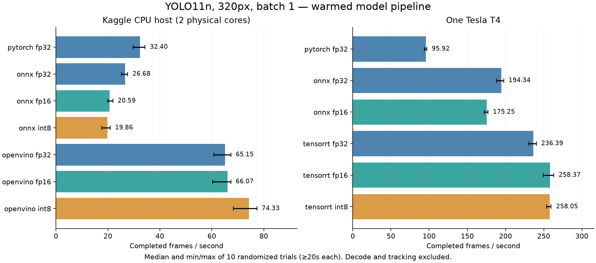
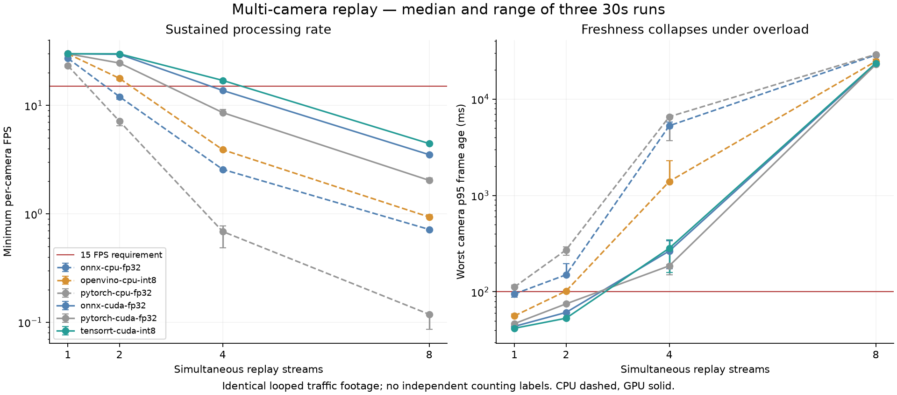

# Kaggle T4 traffic inference study — verified checkpoint analysis

Offline artifact audit: **PASS**, 2753 checks.
No inference, engine builds or new performance experiments were run for this analysis.

## Completed scope

- YOLO11n at 320px; one T4, 2 physical / 4 logical CPU cores, 31.35 GiB RAM.
- 13 runtime/device/precision cases, 10 randomized >=20s timing trials each; 512 calibration and 4488 disjoint COCO evaluation images.
- 72 serving runs: six chosen backend/device configurations × 1/2/4/8 cameras × three 30-second replays.
- 640px was stopped; tuning and independent counting validation are not completed.

## Model results

FPS is median trial throughput; AP losses are absolute percentage points against PyTorch CUDA FP32.

| Case | Median FPS [min, max] | Median trial p95 ms | mAP50–95 | Global / vehicle AP loss (points) | Model MiB |
|---|---:|---:|---:|---:|---:|
| pytorch-cpu-fp32 | 32.40 [29.69, 34.31] | 33.53 | 0.2843 | 0.0001 / 0.0000 | 5.35 |
| pytorch-cuda-fp32 | 95.92 [93.61, 96.96] | 11.60 | 0.2843 | 0.0000 / 0.0000 | 5.35 |
| onnx-cpu-fp32 | 26.68 [25.28, 27.62] | 62.08 | 0.2843 | -0.0000 / 0.0000 | 10.12 |
| onnx-cpu-fp16 | 20.59 [19.95, 21.91] | 74.36 | 0.2843 | 0.0014 / -0.0051 | 5.11 |
| onnx-cpu-int8 | 19.86 [17.68, 20.92] | 77.62 | 0.2504 | 3.3884 / 5.0086 | 2.84 |
| onnx-cuda-fp32 | 194.34 [188.55, 197.59] | 5.49 | 0.2843 | -0.0000 / 0.0000 | 10.12 |
| onnx-cuda-fp16 | 175.25 [172.03, 177.06] | 5.99 | 0.2845 | -0.0226 / -0.0142 | 5.11 |
| openvino-cpu-fp32 | 65.15 [60.77, 67.37] | 16.56 | 0.2843 | 0.0003 / 0.0000 | 10.30 |
| openvino-cpu-fp16 | 66.07 [60.38, 67.35] | 16.49 | 0.2843 | -0.0038 / -0.0050 | 5.40 |
| openvino-cpu-int8 | 74.33 [68.39, 77.37] | 14.51 | 0.2826 | 0.1679 / 0.3265 | 3.20 |
| tensorrt-cuda-fp32 | 236.39 [230.78, 240.25] | 4.39 | 0.2843 | 0.0002 / 0.0000 | 12.60 |
| tensorrt-cuda-fp16 | 258.37 [249.24, 263.14] | 4.00 | 0.2842 | 0.0036 / -0.0012 | 8.29 |
| tensorrt-cuda-int8 | 258.05 [253.88, 259.73] | 3.96 | 0.2769 | 0.7353 / 0.9848 | 6.91 |

## Paired randomized-round throughput comparisons

Exploratory log-ratio t-intervals over ten rounds. They assume approximately independent normal log ratios; one session does not establish multi-day repeatability.

| Candidate / baseline | Geometric-mean ratio | Exploratory 95% interval | First / last five rounds |
|---|---:|---:|---:|
| tensorrt-cuda-fp32 / pytorch-cuda-fp32 | 2.469× | [2.444, 2.494] | 2.472 / 2.466 |
| tensorrt-cuda-fp16 / pytorch-cuda-fp32 | 2.694× | [2.672, 2.716] | 2.716 / 2.672 |
| tensorrt-cuda-fp16 / tensorrt-cuda-fp32 | 1.091× | [1.081, 1.102] | 1.099 / 1.083 |
| tensorrt-cuda-int8 / tensorrt-cuda-fp16 | 0.999× | [0.991, 1.007] | 0.992 / 1.006 |
| openvino-cpu-int8 / openvino-cpu-fp32 | 1.136× | [1.117, 1.156] | 1.141 / 1.131 |

## Interpretation

- TensorRT FP16 is a strong model-level candidate: approximately the same throughput as INT8 with a much smaller measured AP loss.
- The full TensorRT gain over PyTorch is a runtime/configuration comparison, not a speedup caused solely by FP16.
- Auto-selection chose TensorRT INT8 because its median p95 was marginally lower. This is not proof it is a better deployment tradeoff than FP16.
- CPU ONNX INT8 was slower than ONNX FP32 and lost substantial AP in this recipe. Quantization is not universally beneficial.
- OpenVINO FP16 denotes storage compression, and TensorRT flags allow mixed precision; refer to retained runtime inspection.

- 1 timing trial(s) were flagged and retained: onnx-cuda-fp32 round 2: NVML thermal throttle bit observed at a pool boundary, GPU temperature reached 85C; diagnostic, not proof of throttling.

## Serving results

Passing requires every camera to sustain >=15 FPS and <=100ms p95 frame age in all three repeats. Rendering was off in these baseline capacity runs.

| Case | Cameras | Min-camera FPS median | Worst p95 ms median [range] | All three timing pass |
|---|---:|---:|---:|---|
| onnx-cpu-fp32 | 1 | 27.24 | 94.98 [87.67, 97.40] | True |
| onnx-cpu-fp32 | 2 | 12.05 | 150.15 [147.50, 195.86] | False |
| onnx-cpu-fp32 | 4 | 2.57 | 5287.75 [4995.21, 5765.08] | False |
| onnx-cpu-fp32 | 8 | 0.72 | 28667.60 [28576.69, 29538.38] | False |
| onnx-cuda-fp32 | 1 | 29.97 | 43.77 [43.73, 44.98] | True |
| onnx-cuda-fp32 | 2 | 29.63 | 61.08 [60.26, 61.41] | True |
| onnx-cuda-fp32 | 4 | 13.75 | 265.48 [173.62, 337.47] | False |
| onnx-cuda-fp32 | 8 | 3.51 | 23148.14 [22671.22, 23329.38] | False |
| openvino-cpu-int8 | 1 | 29.95 | 56.25 [56.03, 58.96] | True |
| openvino-cpu-int8 | 2 | 17.78 | 101.81 [100.55, 104.32] | False |
| openvino-cpu-int8 | 4 | 3.91 | 1397.81 [1364.86, 2305.46] | False |
| openvino-cpu-int8 | 8 | 0.93 | 24664.13 [24186.16, 26075.20] | False |
| pytorch-cpu-fp32 | 1 | 23.30 | 112.15 [109.42, 117.84] | False |
| pytorch-cpu-fp32 | 2 | 7.16 | 272.03 [239.95, 293.37] | False |
| pytorch-cpu-fp32 | 4 | 0.69 | 6561.88 [3686.08, 6681.92] | False |
| pytorch-cpu-fp32 | 8 | 0.12 | 29108.30 [28437.15, 29375.29] | False |
| pytorch-cuda-fp32 | 1 | 29.97 | 46.75 [46.61, 47.43] | True |
| pytorch-cuda-fp32 | 2 | 24.62 | 74.97 [74.28, 77.31] | True |
| pytorch-cuda-fp32 | 4 | 8.59 | 186.13 [150.58, 192.01] | False |
| pytorch-cuda-fp32 | 8 | 2.04 | 22840.27 [21941.14, 23168.82] | False |
| tensorrt-cuda-int8 | 1 | 29.98 | 41.85 [40.78, 41.85] | True |
| tensorrt-cuda-int8 | 2 | 29.93 | 53.20 [51.27, 54.00] | True |
| tensorrt-cuda-int8 | 4 | 17.02 | 283.64 [159.37, 344.20] | False |
| tensorrt-cuda-int8 | 8 | 4.45 | 23602.90 [22277.61, 23657.13] | False |

## TensorRT INT8 pipeline profile

Shown for repeat 0; full profiles for all 72 runs are in stage-profiles.json. Decode time includes source read; decoder lag measures lateness against scheduled arrival. Quantiles must not be summed.

| Cameras | Aggregate FPS | Decode p95 ms | Decoder-lag p95 ms | Queue p95 ms | Predict p95 ms | Tracking p95 ms | Telemetry p95 ms |
|---|---:|---:|---:|---:|---:|---:|---:|
| 1 | 29.98 | 30.18 | 30.77 | 1.04 | 5.72 | 1.64 | 3.81 |
| 2 | 59.88 | 31.97 | 33.22 | 10.42 | 6.47 | 1.89 | 4.20 |
| 4 | 65.92 | 69.60 | 262.05 | 42.16 | 12.49 | 4.92 | 10.05 |
| 8 | 36.61 | 107.01 | 22543.90 | 79.42 | 20.83 | 10.68 | 14.73 |

## Scope limits and next experiment

- Two cameras are the largest passing tested GPU load under these replay conditions. This is timing-only capacity; counting remains unvalidated.
- Multiple cameras repeat the same short recording. Independent views, RTSP/network behaviour, long-running reliability and human crossing labels remain future work.
- Large multi-camera frame ages coexist with bounded queues because the decoder can deliver frames that are already late. Profile decoder pacing and CPU work before changing the detector.
- A useful next comparison is TensorRT FP16 versus INT8 at two/four streams under the same protocol; FP16 was not selected for these full serving runs.
- AP uncertainty is unmeasured: predictions/image caches were deliberately excluded from the archive. Avoid claims based on tiny AP differences.
- The archive includes real trial/frame evidence, but this audit is not an independent rerun and cannot establish traffic counting correctness.

## Figures

Figures use the saved aggregates; error bars show trial/repeat min/max, not confidence intervals.

